---

**[rudraksha.tech](https://www.rudraksha.tech)**  ·  [LinkedIn](https://linkedin.com/in/rudrakshasingh18)  ·  [rudraksharss@gmail.com](mailto:rudraksharss@gmail.com)

Every card above is an SVG drawn by <code>scripts/render_readme_cards.py</code> from my real contribution and pull-request data, redrawn each morning by a GitHub Action. <a href="./CARDS.md">How it works →</a>
