<a href="https://www.rudraksha.tech"><picture><source media="(prefers-color-scheme: dark)" srcset="./cards/hero.svg"/></picture></a>

<picture><source media="(prefers-color-scheme: dark)" srcset="./cards/graph.svg"/></picture>

<picture><source media="(prefers-color-scheme: dark)" srcset="./cards/activity.svg"/></picture>

<a href="https://github.com/WasThatRudy?tab=repositories"><picture><source media="(prefers-color-scheme: dark)" srcset="./cards/tile-1.svg"/></picture></a> <a href="https://github.com/pulls?q=is%3Apr+author%3AWasThatRudy+is%3Amerged"><picture><source media="(prefers-color-scheme: dark)" srcset="./cards/tile-2.svg"/></picture></a> <a href="https://github.com/pulls?q=is%3Apr+author%3AWasThatRudy+is%3Amerged+-user%3AWasThatRudy"><picture><source media="(prefers-color-scheme: dark)" srcset="./cards/tile-3.svg"/></picture></a>

<picture><source media="(prefers-color-scheme: dark)" srcset="./cards/upstream.svg"/></picture>

<a href="https://github.com/pointblank-club/Zenith"><picture><source media="(prefers-color-scheme: dark)" srcset="./cards/repo-1.svg"/></picture></a> <a href="https://github.com/pointblank-club/Kitten"><picture><source media="(prefers-color-scheme: dark)" srcset="./cards/repo-2.svg"/></picture></a> <a href="https://github.com/WasThatRudy/headlamp-kmesh-plugin"><picture><source media="(prefers-color-scheme: dark)" srcset="./cards/repo-3.svg"/></picture></a>

---

**[rudraksha.tech](https://www.rudraksha.tech)**  ·  [LinkedIn](https://linkedin.com/in/rudrakshasingh18)  ·  [rudraksharss@gmail.com](mailto:rudraksharss@gmail.com)

Every card above is an SVG drawn by <code>scripts/render_readme_cards.py</code> from my real contribution and pull-request data, redrawn each morning by a GitHub Action. <a href="./CARDS.md">How it works →</a>
